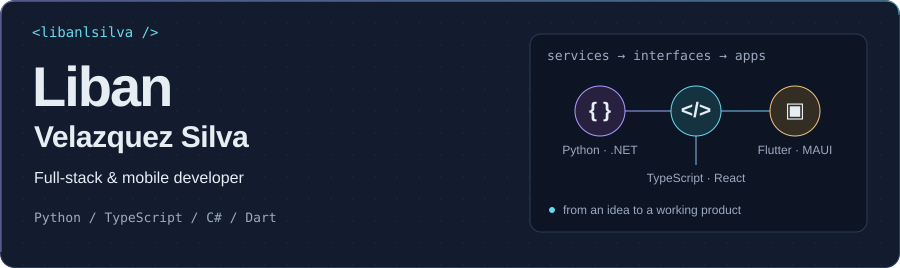
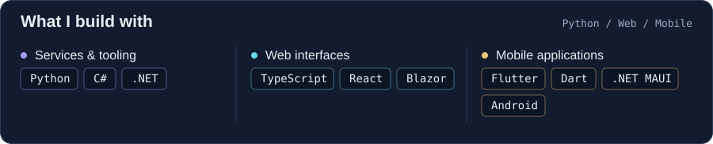
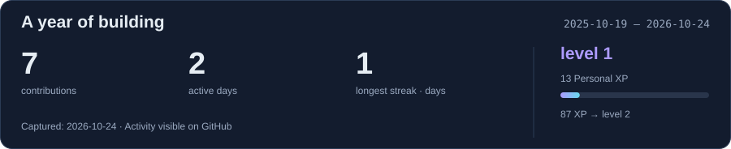
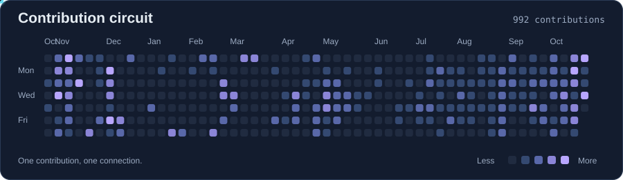

<picture><source media="(max-width: 600px)" srcset="assets/banner-mobile.svg"></picture>

**Hi, I’m Liban.** I build web and mobile applications, developer tools, and integrations that connect services with real products.

<picture><source media="(max-width: 600px)" srcset="assets/stack-en-mobile.svg"></picture>

### Things I build

**[Apklis · .NET MAUI](https://github.com/libanlsilva/maui-apklis-license)**
Apklis license validation and purchases with Transfermóvil for .NET MAUI applications.

C# / .NET MAUI / Android

**[Apklis · Flutter](https://github.com/libanlsilva/apklis_license_validator)**
A Flutter plugin for Apklis license checks and payments, with native Android integration.

Flutter / Dart / Kotlin

I also work with Python, TypeScript, and React on Sovara, and contribute to the .NET and e-commerce ecosystem.

### Activity

<picture><source media="(max-width: 600px)" srcset="assets/stats-en-mobile.svg"></picture>

Snapshot captured: 2026-10-26. Personal XP = contributions + 3 × active days.

[Explore my repositories](https://github.com/libanlsilva?tab=repositories)
