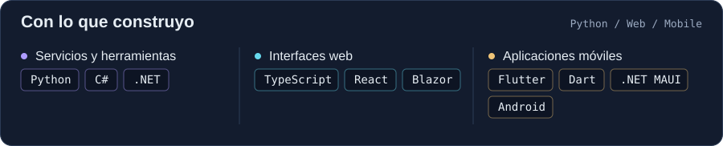
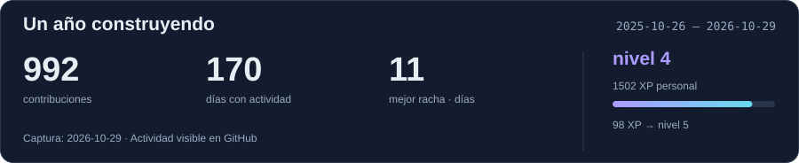
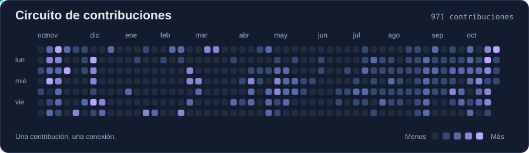

<picture><source media="(max-width: 600px)" srcset="assets/banner-mobile.svg"></picture>

**Hola, soy Liban.** Construyo aplicaciones web y móviles, herramientas para desarrolladores e integraciones que conectan servicios con productos reales.

<picture><source media="(max-width: 600px)" srcset="assets/stack-mobile.svg"></picture>

### Lo que construyo

**[Apklis · .NET MAUI](https://github.com/libanlsilva/maui-apklis-license)**
Validación y compra de licencias de Apklis con Transfermóvil, desde aplicaciones .NET MAUI.

C# / .NET MAUI / Android

**[Apklis · Flutter](https://github.com/libanlsilva/apklis_license_validator)**
Plugin de Flutter para consultar licencias y gestionar pagos de Apklis con integración nativa de Android.

Flutter / Dart / Kotlin

También trabajo con Python, TypeScript y React en Sovara, y contribuyo al ecosistema .NET y al comercio electrónico.

### Actividad

<picture><source media="(max-width: 600px)" srcset="assets/stats-mobile.svg"></picture>

Instantánea capturada: 2026-10-30. XP personal = contribuciones + 3 × días activos.

[Explora mis repositorios](https://github.com/libanlsilva?tab=repositories)
